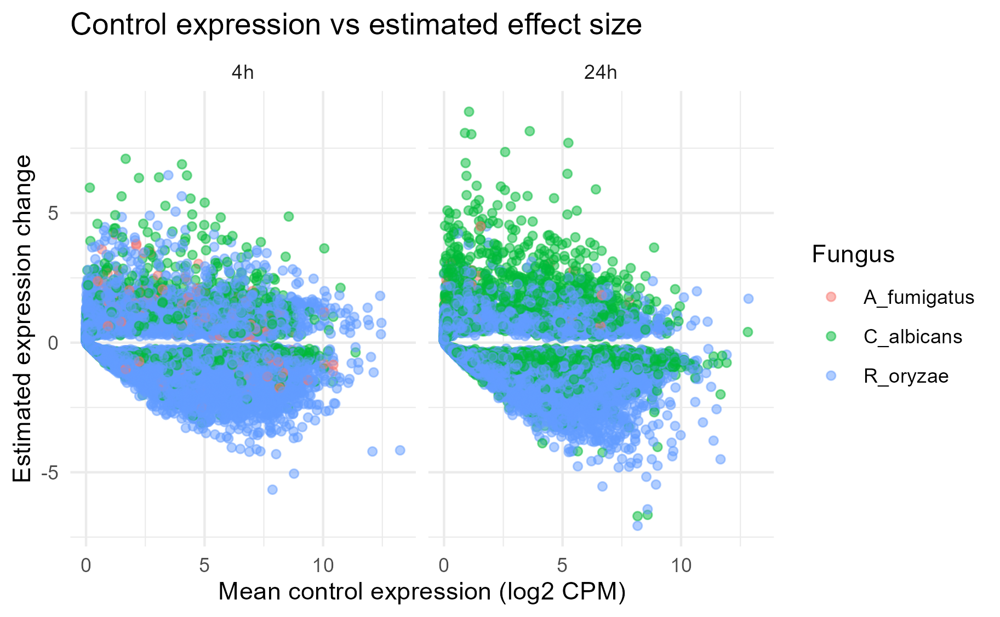
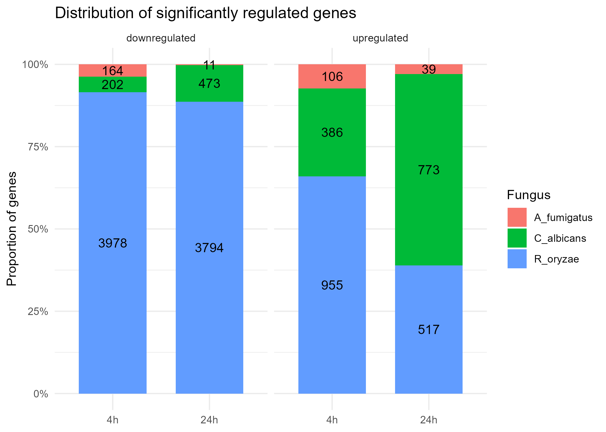
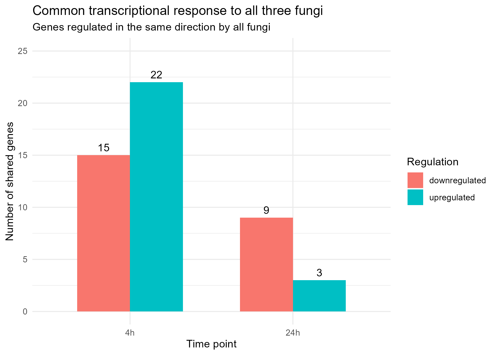
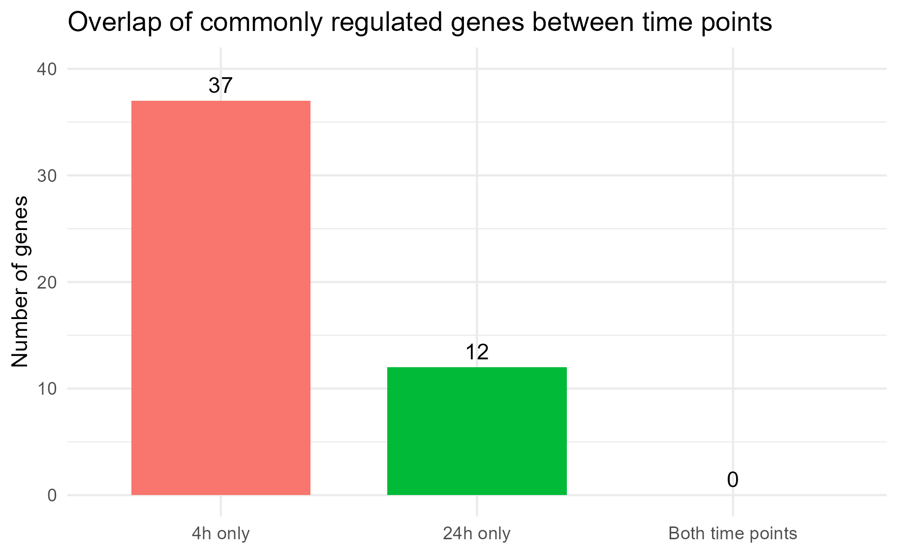

## Background {.smaller}

Three important human fungal pathogens:

- *A. fumigatus*, *C. albicans* and *R. oryzae*

Fungal exposure triggers immune responses and changes host gene expression.

Different fungi may activate different host defence mechanisms.

::: notes
About 1 minute. Set the scene: three fungi, and the question of whether the immune system responds to each one in the same way.
:::

## Aim and research questions {.smaller}

**Aim:** compare host gene expression responses to three fungal pathogens and identify shared antifungal responses, species-specific responses and time-dependent changes.

**Research questions**

1.  **Overall response:** Do the fungal stimulations give distinct expression profiles? How do samples cluster by fungus and time point?
2.  **Inflammatory markers:** How do CXCL8, IL1B, IL6 and TNF respond, and how does this change from 4 h to 24 h?
3.  **Differential expression:** Which genes go up or down versus control, and how do these responses differ by species and time?

::: notes
About 1 minute. Read out the three research questions. The rest of the talk follows the team's analyses.
:::

## For Teo: descriptive and summary statistics {.smaller}

*Placeholder. Teo to add 1 to 3 slides here.*

- Sample sizes per fungus, time point and donor
- Summary statistics of the expression data
- Statistical tests and what they show

::: notes
Teo: replace this slide with your descriptive and statistics content. Keep it to 1 to 3 slides, and reduce the deck to 10 slides in total if you add more.
:::


## Individual gene expression responses

:::: {.columns}

::: {.column width="50%"}

**Baseline expression vs. estimated effect size**

```{r}
#| echo: false
#| out-width: "100%"


```

:::

::: {.column width="50%"}

**Who drives the response, and in which direction**

```{r}
#| echo: false
#| out-width: "100%"


```

:::

:::: {.smaller}

- *R. oryzae* accounts for about 92% of downregulated genes at 4 h and 89% at 24 h, so most of the transcriptional shutdown is specific to this fungus.
- The upregulated side changes over time: *R. oryzae* gives 66% of upregulated genes at 4 h, but *C. albicans* gives 58% at 24 h.
- The largest fold changes sit among lowly expressed genes (left of the scatter plot), so strong effects in that range need more caution than moderate changes in highly expressed genes.

<small>
Significant genes: BH-adjusted q-value < 0.05. Upregulated and downregulated genes have estimated effects above 1 or below -1.
</small>


## Shared transcriptional responses across fungi

We looked for genes regulated in the same direction by all three fungi, separately at each time point.

:::: {.columns}

::: {.column width="50%"}

```{r}
#| echo: false
#| out-width: "100%"


```

:::

::: {.column width="50%"}

```{r}
#| echo: false
#| out-width: "100%"


```

:::

:::: {.smaller}

- The early shared response is mostly upregulation (22 up, 15 down), which fits a rapid, general activation of host defence.
- The late shared response flips to mostly downregulation (9 down, 3 up), so the common programme changes character over time.
- Only 37 shared genes are specific to 4 h and 12 to 24 h, and none persist at both time points. The fungi share a response, but not a stable one.


## Greta: *C. albicans* against control {.smaller}

::::: columns
::: {.column width="48%"}
| Direction | Article 4 h | Our 4 h | Article 24 h | Our 24 h |
|-----------|------------:|--------:|-------------:|---------:|
| Up        |         821 |     420 |         1733 |      934 |
| Down      |         234 |     222 |          715 |      506 |

- Same log2 fold change and adjusted p-value thresholds as the article
- Model fitted per gene without DESeq2, so counts differ from the article
- Counts are close to Martina's *C. albicans* results
:::

::: {.column width="52%"}
{width="100%"}
:::
:::::

::: notes
About 1.5 minutes. Greta's analysis, analysis_greta.qmd. Our counts come from her per-gene models. The article counts are the ones she recorded from the paper. Her 24 h article total is recorded there as "1055" in one line, which looks like a copy error. The table uses the article's 24 h values, 1733 up and 715 down.
:::

## Swastika: placeholder {.smaller}

*Placeholder. Swastika's analysis is not in the repository yet.*

- Analysis question
- Method
- Main result

::: notes
Swastika: add your analysis here once it is pushed to the R folder of the repository.
:::

## Anastasia: placeholder {.smaller}

*Placeholder. Anastasia's analysis is not in the repository yet.*

- Analysis question
- Method
- Main result

::: notes
Anastasia: add your analysis here once it is pushed to the R folder of the repository.
:::

## Conclusion {.smaller}

- *R. oryzae* gives the strongest transcriptional response in these analyses, mostly as downregulation
- A set of 49 genes is shared by all three fungi, mostly at 4 h
- *C. albicans* results look similar across Martina's and Greta's models, but are below the article's counts
- Teo's statistics, and Swastika's and Anastasia's results, to be added

**Questions?**

::: notes
About 1 minute. This is a draft built from the current analyses. The team should check the wording and fill in the remaining sections before presenting.
:::
